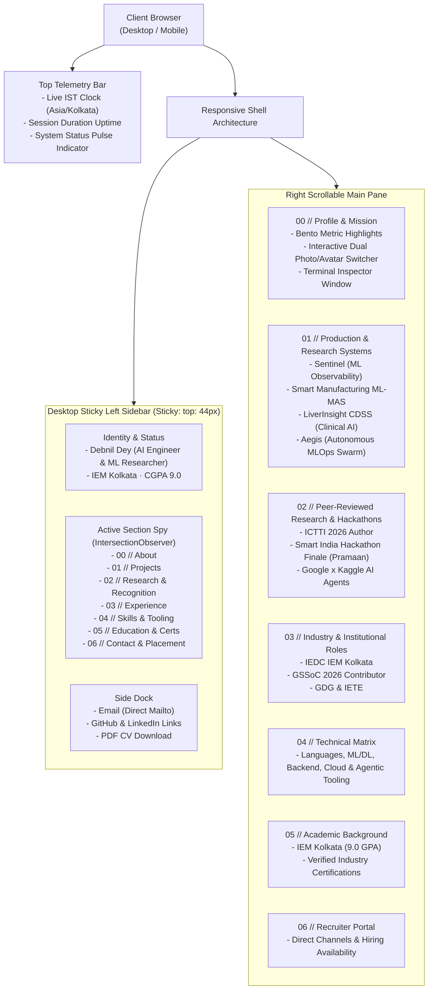
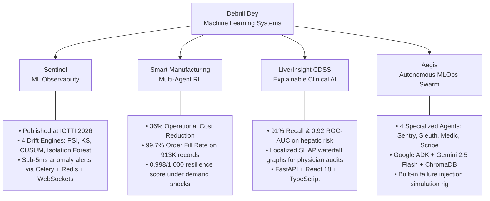
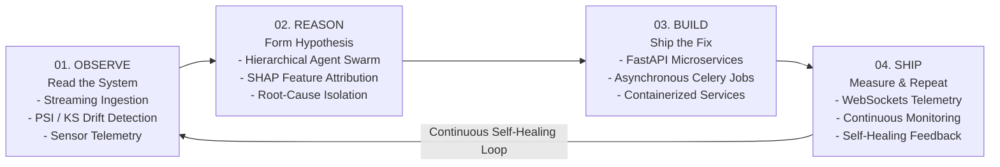

<div align="center">

# ⚡ Debnil Dey — Personal Portfolio & AI Systems Showcase

> **High-performance, zero-dependency developer portfolio engineered for technical recruiters, engineering leaders, and research collaborators.**

[](https://debddj.github.io/portfolio/)
[](https://debddj.github.io/portfolio/)
[](LICENSE)
[](https://debddj.github.io/portfolio/#education)
[](https://debddj.github.io/portfolio/#research)

<p align="center">
  <a href="#-executive-summary">Executive Summary</a> •
  <a href="#-system-architecture">System Architecture</a> •
  <a href="#-interactive-runtime-features">Interactive Features</a> •
  <a href="#-flagship-projects-showcased">Flagship Projects</a> •
  <a href="#-closed-loop-agentic-pipeline">Agentic Pipeline</a> •
  <a href="#-run-locally">Run Locally</a> •
  <a href="#-deployment">Deployment</a> •
  <a href="#-recruiter-fast-track">Recruiter Portal</a>
</p>

---

</div>

## 📌 Executive Summary

This repository hosts the source code for the personal engineering portfolio of **Debnil Dey**, an AI Engineer and ML Researcher currently in his third year of B.Tech Computer Science & Engineering (Artificial Intelligence) at the **Institute of Engineering & Management (IEM), Kolkata** (2024–2028).

The portfolio is designed with a **terminal-inspired, high-contrast dark aesthetic** (`#090D14` void palette with teal `#4FD1C5` and amber `#FF9E2C` accents) that demonstrates both theoretical rigor and systems engineering craft. It showcases peer-reviewed research, production-grade multi-agent architectures, clinical AI with explainability, and real-time ML observability platforms.

- **Live URL**: [https://debddj.github.io/portfolio/](https://debddj.github.io/portfolio/)
- **GitHub**: [@Debddj](https://github.com/Debddj)
- **LinkedIn**: [debnil-dey](https://www.linkedin.com/in/debnil-dey-359a25393/)
- **Primary Email**: [debddj24@gmail.com](mailto:debddj24@gmail.com)

---

## 🏗️ System Architecture

The site operates on a **zero-dependency, pure client-side architecture**: a single self-contained `index.html` file bundling semantic markup, responsive CSS grid/flexbox layouts, custom keyframe animations, and a micro-footprint vanilla JavaScript telemetry engine.



---

## 🔬 Core Engineering Highlights

| Pillar | Engineering Specification | Recruiter Value |
| :--- | :--- | :--- |
| **Zero Dependencies** | Pure HTML5, modern CSS custom variables, and vanilla JS. No NPM build step, bundler, or heavy framework. | 100/100 Lighthouse performance, sub-second load times, instant render. |
| **Live Telemetry** | Active JavaScript runtime calculating real-time IST clock and session duration. | Demonstrates systems-level attention to detail and real-time state management. |
| **Active Scroll Spy** | Dynamic `IntersectionObserver` syncing URL hashes and active sidebar indicators. | Seamless, non-intrusive navigation across 7 detailed sections. |
| **Interactive Avatar Switcher** | DOM state toggle between physical photo (`HUMAN IN THE LOOP`) and AI avatar (`AGENTIC RUNTIME`). | Visualizes the symbiosis between human craft and autonomous AI pipelines. |
| **Semantic Accessibility** | Skip-to-content links, visible `:focus-visible` rings, ARIA landmark roles, and high-contrast typography. | Meets WCAG AA/AAA web standards and screen-reader requirements. |
| **SEO & Schema.org** | Integrated `schema.org/Person` JSON-LD structured data and OpenGraph tags. | Ensures first-page crawler indexing and rich snippet rendering on LinkedIn/Twitter. |

---

## ⚡ Interactive Runtime Features

### 1. Live Header Telemetry
- **Live IST Clock**: Formatted via JavaScript `Intl` API using the `Asia/Kolkata` time zone.
- **Session Duration Timer**: Continuously tracks browsing elapsed time (`SESSION HH:MM:SS`) since DOM initialization.
- **Status Radar**: CSS keyframe pulsing dot representing 24/7 availability for engineering roles.

### 2. Dual Photo & Avatar Switcher
Visitors can toggle between two modes using custom state switching:
- **`👤 Physical`**: Loads the authentic portrait photo with the amber status badge `"HUMAN IN THE LOOP"`.
- **`🤖 AI Avatar`**: Switches to the stylized AI agent illustration and updates the badge to `"AGENTIC RUNTIME"` with teal luminescence.

### 3. Interactive Terminal Inspector
An in-browser CLI window simulating an active agentic shell session:
```bash
$ whoami
Debnil Dey — B.Tech CSE (AI), IEM Kolkata · 2024–2028 · CGPA 9.0

$ current_focus
multi-agent reinforcement learning · ML observability · low-latency inference

$ core_mission
bridging deep learning theory with robust, fault-tolerant production services
```

---

## 🛠️ Flagship Projects Showcased



### Detailed Systems Breakdown

#### 1. [Sentinel — Real-Time ML Observability Platform](https://github.com/Debddj/Sentinel)
- **Publication**: Accepted and presented at the *International Conference on Transdisciplinary Technology & Innovation (ICTTI 2026)*.
- **Core Technology**: Asynchronous multi-engine drift detection utilizing Population Stability Index (PSI), Kolmogorov-Smirnov (KS) test, CUSUM, and Isolation Forest.
- **Stack**: FastAPI, PostgreSQL, Celery, Redis, WebSockets, React, TypeScript.

#### 2. [Smart Manufacturing ML-MAS](https://github.com/Debddj/smart-manufacturing-ml-mas)
- **Domain**: Multi-Agent Reinforcement Learning (MARL) for Industry 4.0 autonomous supply chain coordination.
- **Benchmark Metrics**: **36% cost reduction**, **99.7% order fill rate** across 913,000 transaction records, and **0.998 / 1.000 resilience score** under sudden demand shocks.
- **Stack**: Reinforcement Learning, Multi-Agent Systems, FastAPI, React, MessageBus Event Architecture.

#### 3. [LiverInsight CDSS — Clinical Decision Support](https://github.com/Debddj/LiverInsight-CDSS-Clinical-Decision-Support-System-)
- **Domain**: Clinical hepatic risk prediction with explainable AI (XAI).
- **Clinical Validation**: Validated XGBoost classifier achieving **91% recall**, **84% precision**, and **0.92 ROC-AUC** paired with localized SHAP waterfall graphs for physician audits.
- **Stack**: XGBoost, SHAP, FastAPI, React 18, TypeScript.

#### 4. [Aegis — Autonomous Multi-Agent MLOps Swarm](https://github.com/Debddj/Aegis) | [Live Demo](https://aegis-dun-rho.vercel.app)
- **Domain**: Self-healing machine learning infrastructure.
- **Architecture**: A 4-agent coordinated pipeline (*Sentry* detects drift → *Sleuth* traces root-cause → *Medic* applies auto-remediation → *Scribe* logs postmortems) with ChromaDB persistent memory and human approval gating.
- **Stack**: Google ADK, Gemini 2.5 Flash, ChromaDB, FastAPI, React, Docker.

---

## 🔄 Closed-Loop Agentic Pipeline

The underlying philosophy guiding all systems engineered in this portfolio is the **Closed-Loop Agentic Workflow**:



---

## 📂 Repository Structure

```
portfolio/
├── index.html                   # Master single-page application (Markup, CSS Variables, JS Runtime)
├── assets/
│   ├── debnil_original.png      # Authentic portrait photograph (Physical Mode)
│   ├── debnil_avatar.png        # Stylized digital AI agent illustration (Agentic Mode)
│   └── Debnil_Dey_CV.pdf        # Formal curriculum vitae for recruiters and hiring teams
└── README.md                    # Designer-grade technical documentation and systems manual
```

---

## 💻 Run Locally

Because the portfolio is engineered without any external build tooling or bundler dependencies, it runs natively on any modern browser or simple HTTP file server.

### Option 1: Python Built-in Server (Recommended)

```bash
# 1. Clone the repository
git clone https://github.com/Debddj/portfolio.git

# 2. Enter directory
cd portfolio

# 3. Launch HTTP server on port 8000
python -m http.server 8000
```
Open **`http://localhost:8000`** in your browser.

### Option 2: Node.js / npx `serve`

```bash
npx serve .
```

### Option 3: Direct File Access
Simply double-click [`index.html`](index.html) to open it directly via the `file:///` protocol in Chrome, Firefox, Safari, or Edge.

---

## ⚙️ Content & Theme Customization

- **Content Updates**: All project summaries, publication notices, and academic milestones reside in semantic `<section>` blocks with clear IDs (`#about`, `#projects`, `#research`, `#experience`, `#skills`, `#education`, `#contact`).
- **Color Tokens**: CSS custom properties are declared at the head of `<style>`:
  ```css
  :root {
    --void: #090D14;         /* Primary deep background */
    --surface: #121824;      /* Card and container surface */
    --rule: #202B3C;         /* Subtle structural borders */
    --teal: #4FD1C5;         /* Primary technical accent */
    --amber: #FF9E2C;        /* Secondary human-in-the-loop accent */
  }
  ```
- **Resume Updates**: Replace `assets/Debnil_Dey_CV.pdf` with your updated PDF using the identical filename.

---

## 🚀 Continuous Deployment

The website is continuously deployed through **GitHub Pages**:
1. Repository Settings → **Pages**.
2. Source: **Deploy from a branch**.
3. Branch: **`main`** / Folder: **`/ (root)`**.
4. Every push to the `main` branch immediately triggers the automated GitHub Pages deployment pipeline and updates [debddj.github.io/portfolio](https://debddj.github.io/portfolio/).

---

## 🎯 Recruiter Fast-Track Portal

If you are an engineering hiring manager, talent partner, or research scientist evaluating candidates, here is the executive summary:

- **Current Status**: 3rd-Year B.Tech CSE (AI) @ IEM Kolkata (2024–2028).
- **Academic Merit**: Cumulative GPA **9.0 / 10.0**.
- **Role Targets**: AI Engineering Intern, Machine Learning Systems Engineer, MLOps / Backend Engineer, Applied AI Researcher.
- **Mobility**: Available for hybrid/on-site arrangements in **Bengaluru, Hyderabad, NCR, Pune**, as well as global remote teams.
- **Direct Contact**: [debddj24@gmail.com](mailto:debddj24@gmail.com) | [LinkedIn Profile](https://www.linkedin.com/in/debnil-dey-359a25393/)

---

## 📄 License

This project is open-source and distributed under the **[MIT License](LICENSE)**.

<div align="center">
  <sub>Built with precision, human craft, and agentic workflows by <b>Debnil Dey</b> · Kolkata, India.</sub>
</div>
